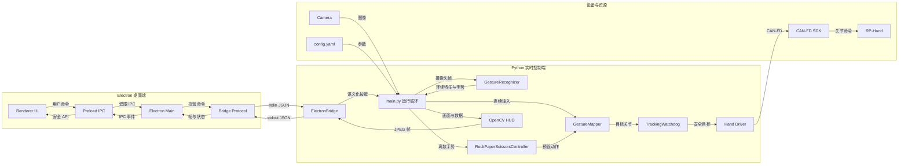

# RP-Hand 当前程序架构

## 结构图

## 模块职责

| 模块 | 当前职责 |
| --- | --- |
| `electron/renderer` | 启动页、摄像头画面、识别/发送开关、模式选择、急停与恢复交互 |
| `electron/main.cjs` | Electron 窗口和 Python 子进程生命周期、IPC 转发 |
| `electron/bridge-protocol.cjs` | GUI 命令白名单、Python 启动参数、帧状态校验 |
| `electron_bridge.py` | JSON 命令转为控制事件，并把 JPEG 与运行状态写回 Electron |
| `main.py` | 组装依赖、实时循环、模式选择、发送调度和 HUD 编排 |
| `gesture_recognizer.py` | MediaPipe 关键点、连续弯曲度、捏合强度和离散手势识别 |
| `gesture_mapping.py` | 输入校准、捏合辅助、连续映射和预设动作映射 |
| `rock_paper_scissors.py` | 猜拳稳定帧、冷却、重新武装和反制动作选择 |
| `control_safety.py` | 丢失跟踪、回张、保持、急停和受控恢复状态机 |
| `drivers/*` | 仿真或 LHandPro CAN-FD 硬件访问 |
| `app_runtime.py` | 摄像头、识别器和驱动的确定性释放 |

## 当前架构问题

### P1: `main.py` 仍承担过多职责

猜拳已拆出，但 `main.py` 仍同时处理实时循环、手势触发模式、键盘/GUI 命令、HUD 数据准备和发送调度。下一步最值得拆的是：

1. `GesturePresetController`：承接稳定帧与预设动作触发。
2. `RuntimeCommandHandler`：承接暂停、识别开关、急停、恢复和模式切换。
3. `HudRenderer`：把 `draw_hud` 从主循环移出。

### P1: Electron 控件依赖 Python 合成画面的固定位置

Python 先把数据栏画进 JPEG，Electron 再按相同像素区域叠加真实按钮。两边通过 `320px` 面板宽度形成隐式约定；以后更换分辨率或重新排版时容易错位。

长期建议让 Python 只发送原始画面和结构化 telemetry，由 Electron 完整渲染数据栏。当前版本先保持不动，避免影响真机路径。

### P2: GUI 命令仍以“虚拟键码”进入运行循环

Electron 发送的是语义命令，但 Python bridge 最终把它转换成键码，和 TUI 共用分支。这能复用行为，却让协议与键盘绑定。后续可以引入 `ControlCommand` 枚举，同时保留 TUI 键盘到命令的适配器。

### P2: JPEG Base64 经 stdout 传输

实现简单、打包稳定，但每帧都要 JPEG 编码、Base64 扩容和 JSON 解析。当前帧率可接受时无需立刻替换；若之后需要更高分辨率或更低延迟，再评估本地 MJPEG、共享内存或独立视频通道。

### P3: 配置仍是跨模块裸字典

`config.yaml` 缺少统一的强类型校验。建议以后引入 dataclass 配置模型，在启动阶段一次性验证，避免运行数分钟后才因字段问题退出。

## 推荐演进顺序

1. 先拆 `GesturePresetController`，继续减少 `main.py` 的模式状态。
2. 再拆命令处理器，但不改变急停优先级与恢复流程。
3. 最后把 HUD telemetry 结构化，再考虑 Electron 统一渲染。
4. 视频传输和强类型配置属于性能/工程增强，不阻塞当前真机使用。
